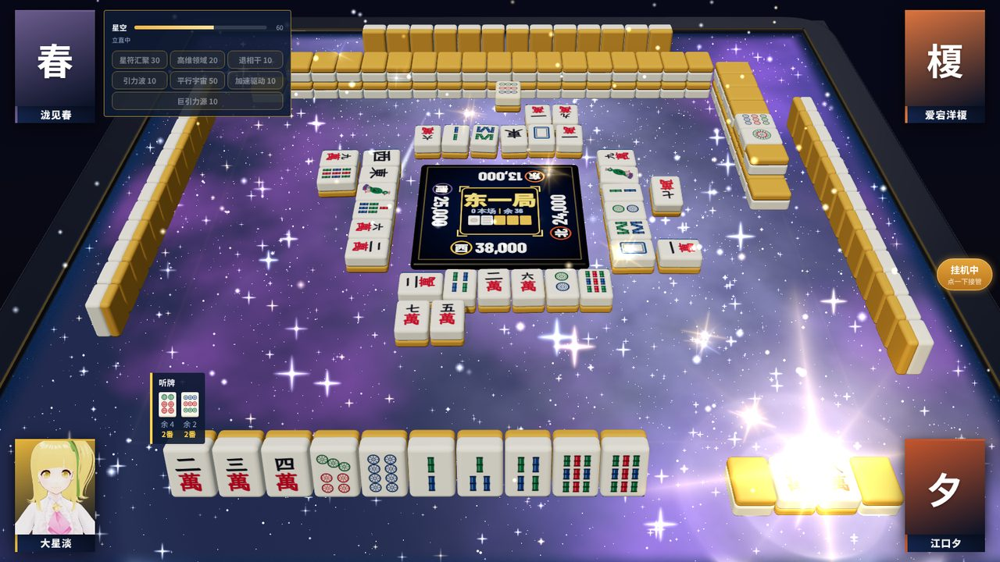
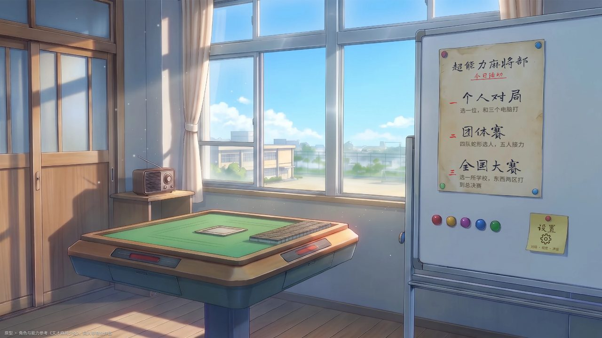
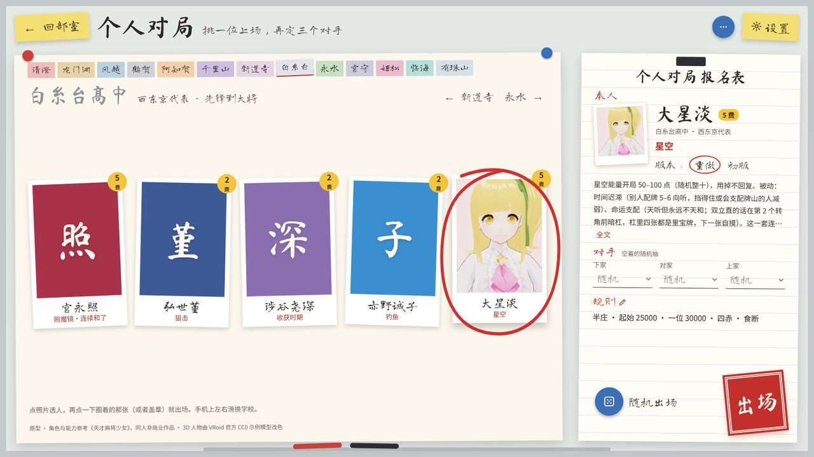
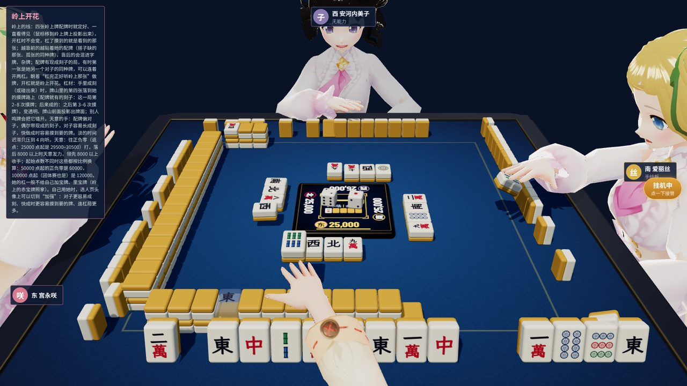
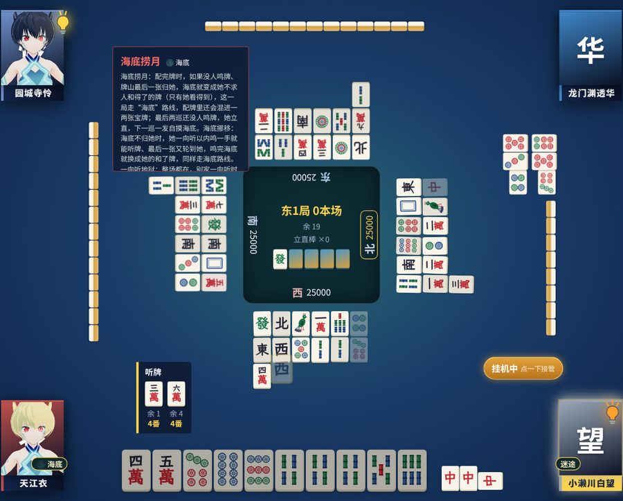

# 超能力麻将 · 天才麻将少女同人网页麻将

把《天才麻将少女》（咲-Saki-）里各位角色的超能力做进立直麻将：宫永咲的岭上开花、大星淡的双立直和星空、天江衣的海底捞月、宫永照的连续和了……打开网页就能玩，不用下载、不用注册，电脑和手机的浏览器都行。

**▶ 在线试玩：https://chaseyun-ai.github.io/saki-mahjong/**

[](https://chaseyun-ai.github.io/saki-mahjong/)
[](https://github.com/chaseyun-ai/saki-mahjong/releases)


[English](#english) · [日本語](#日本語)



## 截图

| 麻将部部室（主页） | 选人：按学校、先锋到大将排好 |
| --- | --- |
|  |  |
| **3D 视角：人物坐在桌边（实验中）** | **2D 平面牌桌：最省电** |
|  |  |

## 能玩什么

- **三种玩法**：个人对局（选一位，和三个电脑打）、团体赛（四队蛇形选人，先锋到大将五人接力）、全国大赛（选一所学校，东西两区打到总决赛，另有个人赛）
- **65 位角色、13 所学校，其中 49 位有超能力**。能力只交换还没公开的牌，不凭空造牌；谁先动、谁说了算有一套固定的顺序，所以能力之间会互相克制，比如照魔镜看穿别人、霍亚乌封印能力、佛灭让整场能力失效
- **规则对标雀魂**：标准役种和役满、番符计分、途中流局。局数、起始点数、赤宝牌、食断、番缚、击飞都能在对局设置里改
- **三种视角**：2.5D（默认）、3D（人物坐在桌边，实验中）、2D 平面；8 套界面皮肤，另有自动麻将机、原木、深夜、翻牌屏等几种牌桌风格
- **能力演出**：岭上开花的旋风和百合花瓣、淡的星空和巨引力源、衣的夜海和月亮、照的龙卷风自摸、哩的锁链和钥匙……全部是程序画出来的，不用原作图片
- **会用能力的电脑**：电脑对手照原作的打法用自己的能力，浩子会针对别人的能力打断，洋榎读得出铳牌
- **能力痕迹**：每局结算时告诉你，这一局牌山被谁的能力动过
- **声音**：音效、背景音乐、角色语音的格子都有，语音和音乐可以放自己的文件
- **素材导入**：头像、立绘、3D 模型（VRM）、语音、音乐都能换成自己的，拖进来自动认出是谁的哪一格（见下面）

## 角色一览

按原作比赛的出场顺序排，和游戏里的选人页一样。「」里是能力名，没写的是没有能力的角色。

| 学校 | 先锋 | 次锋 | 中坚 | 副将 | 大将 |
| --- | --- | --- | --- | --- | --- |
| 清澄（长野） | 片冈优希<br><sub>东风之神</sub> | 染谷真子<br><sub>牌谱记忆</sub> | 竹井久<br><sub>恶待</sub> | 原村和<br><sub>天使和</sub> | 宫永咲<br><sub>岭上开花</sub> |
| 龙门渊（长野） | 井上纯<br><sub>流向</sub> | 泽村智纪 | 国广一 | 龙门渊透华<br><sub>治水</sub> | 天江衣<br><sub>海底捞月</sub> |
| 风越（长野） | 福路美穗子<br><sub>右眼</sub> | 吉留未春 | 文堂星夏 | 深堀纯代 | 池田华菜<br><sub>背水</sub> |
| 鹤贺（长野） | 津山睦月 | 妹尾佳织<br><sub>新手运</sub> | 蒲原智美 | 东横桃子<br><sub>隐身</sub> | 加治木由美<br><sub>沉着</sub> |
| 阿知贺（奈良） | 松实玄<br><sub>宝牌聚集</sub> | 松实宥<br><sub>暖色牌</sub> | 新子憧<br><sub>速攻·距离感</sub> | 鹭森灼<br><sub>保龄球</sub> | 高鸭稳乃<br><sub>深山</sub> |
| 千里山（北大阪） | 园城寺怜<br><sub>一巡先见</sub> | 二条泉 | 江口夕<br><sub>火力</sub> | 船久保浩子 | 清水谷龙华<br><sub>怜的膝枕·无极天</sub> |
| 新道寺（福冈） | 花田煌<br><sub>不会被击飞</sub> | 安河内美子 | 江崎仁美 | 白水哩<br><sub>番缚</sub> | 鹤田姬子<br><sub>钥匙</sub> |
| 白糸台（西东京） | 宫永照<br><sub>照魔镜·连续和了</sub> | 弘世堇<br><sub>狙击</sub> | 涉谷尧深<br><sub>收获时期</sub> | 亦野诚子<br><sub>钓鱼</sub> | 大星淡<br><sub>星空</sub> |
| 永水（鹿儿岛） | 神代小莳<br><sub>神降</sub> | 狩宿巴 | 泷见春<br><sub>黑糖</sub> | 薄墨初美<br><sub>里鬼门</sub> | 石户霞<br><sub>请神·绝一门</sub> |
| 宫守（岩手） | 小濑川白望<br><sub>迷途之家</sub> | 爱丽丝<br><sub>手绘板</sub> | 鹿仓胡桃<br><sub>默听</sub> | 臼泽塞<br><sub>镜片</sub> | 姊带丰音<br><sub>六曜</sub> |
| 姬松（南大阪） | 上重漫<br><sub>爆发</sub> | 真濑由子 | 爱宕洋榎<br><sub>读牌</sub> | 爱宕娟慧<br><sub>一筒</sub> | 末原恭子<br><sub>凡人的抗争</sub> |
| 临海（东东京） | 辻垣内智叶<br><sub>居合</sub> | 郝慧宇<br><sub>国标</sub> | 雀明华<br><sub>风神</sub> | 梅根·达文<br><sub>决斗</sub> | 涅莉·薇萨拉兹<br><sub>运势·七姐妹</sub> |
| 有珠山（北海道） | 本内成香 | 桧森誓子 | 岩馆摇杏 | 真屋由晖子<br><sub>左手</sub> | 狮子原爽<br><sub>五色云·神威</sub> |

每位角色的能力具体怎么算、电脑怎么打、特效长什么样，写在 [角色能力和演出详解](docs/abilities.md)。

## 本地运行

需要 [Node.js](https://nodejs.org/) 20 或更新的版本。

```bash
git clone https://github.com/chaseyun-ai/saki-mahjong.git
cd saki-mahjong
npm install
npm run dev      # 打开终端里显示的地址
```

其他常用命令：

```bash
npm run assets   # 打开素材导入页（Windows 上双击「素材导入.bat」也一样）
npm test         # 规则和整场模拟测试
npm run build    # 类型检查 + 打包到 dist/
```

背景音乐不在仓库里（授权不允许单独再分发曲子文件），所以自己跑起来没有音乐，别的都一样。平衡测试脚本、代码结构、能力系统怎么接，见 [开发说明](docs/development.md)。

## 素材导入

想把头像、切入图、技能动画、3D 模型、手模、语音、提示音、背景音乐换成自己的，不用改代码，也不用手动改文件名。不打开这一页，游戏就照原样。

- **怎么打开**：选人页的设置 → 视觉 → 素材 →「素材导入」；或者在网址后面加 `#assets`；本地开发时双击 `素材导入.bat`（或 `npm run assets`）
- **拖进来就行**：单个文件、整个文件夹、zip 都可以。照文件名和文件夹名认出是谁的哪一格，中文名、日文名、单名、罗马字都认（比如 `大星淡/立直.wav` 是大星淡的立直语音，`涅莉.vrm` 是涅莉的 3D 模型）。导入前先列一张对照表，认错的可以在下拉框里改
- **存在哪里**：存在自己的浏览器里（发布的网页版也能用，只影响自己，一个开关就能换回原版）；本地开发时还可以直接写进项目的 `public/custom/`，提交以后所有人都有
- **素材包**：导出成一个 zip，换电脑、换浏览器时导回去就全部还原

细节见 [开发说明 · 素材导入](docs/development.md#素材导入)。

## 发布

网页版发在 GitHub Pages，只有推版本标签（`v0.2` 这样）时才更新，并自动建一个 Release；平时推 `main` 不会改动网页。具体做法见 [开发说明 · 发布网页版](docs/development.md#发布网页版)。

## 致谢和素材来源

- 3D 人物：[VRoid 官方的 CC0 示例模型](https://opengameart.org/content/vroid-studio-cc0-models)改色，选人页的立绘也是用这些模型渲染的
- 牌面字体：[霞鹜文楷 TC](https://github.com/lxgw/LxgwWenkaiTC)（SIL Open Font License 1.1）
- 特效手法参考：[Humpalumps/ultra-elements](https://github.com/Humpalumps/ultra-elements)（MIT）、Evan Wallace 的 [WebGL Water](https://madebyevan.com/webgl-water)（MIT），代码为本项目重写，版权声明见 [THIRD_PARTY_NOTICES.md](THIRD_PARTY_NOTICES.md)
- 番缚的音效：[效果音ラボ](https://soundeffect-lab.info/)

## 免责声明

本项目是《天才麻将少女》（咲-Saki-，原作：小林立）的粉丝同人作品，免费、非商业，与原作者、出版社、动画制作方都没有关系，也没有得到官方授权。角色名称和设定的相关权利归原权利人所有。游戏里没有使用原作的图片和音频。如果权利人认为有不妥的地方，请开一个 [Issue](https://github.com/chaseyun-ai/saki-mahjong/issues) 联系，会尽快处理。

---

## English

**Saki Superpower Mahjong** is a free, fan-made riichi mahjong game you play in the browser, based on *Saki* (咲-Saki-). Pick one of 65 characters from 13 schools, 49 of them with their own superpower: Saki's rinshan kaihou, Awai's double riichi and starry sky, Koromo's haitei raoyue, Teru's consecutive wins, and more. It has single matches, team battles and a national tournament mode, with 2.5D, 3D and 2D tables. The interface is in Chinese.

**Play now: https://chaseyun-ai.github.io/saki-mahjong/**

Run locally with `npm install && npm run dev` (Node.js 20+). This is an unofficial fan project, not affiliated with the original author, publisher or anime studios.

## 日本語

**超能力麻将**は、『咲-Saki-』のキャラクターの能力を再現した、非公式・非営利のファンメイドのブラウザ麻雀です。13 校 65 人（能力持ちは 49 人）から選べて、宮永咲の嶺上開花、大星淡のダブルリーチと星空、天江衣の海底撈月、宮永照の連続和了などを再現しています。個人戦・団体戦・全国大会モード、2.5D / 3D / 2D の卓があります。ダウンロード不要でブラウザからすぐ遊べます（UI は中国語です）。

**プレイ：https://chaseyun-ai.github.io/saki-mahjong/**

原作者・出版社・アニメ制作会社とは関係のない、非公式のファン作品です。
